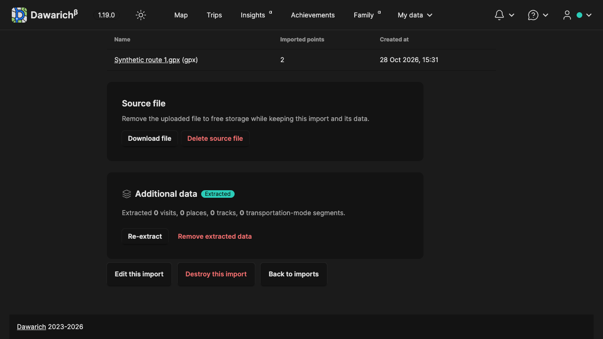
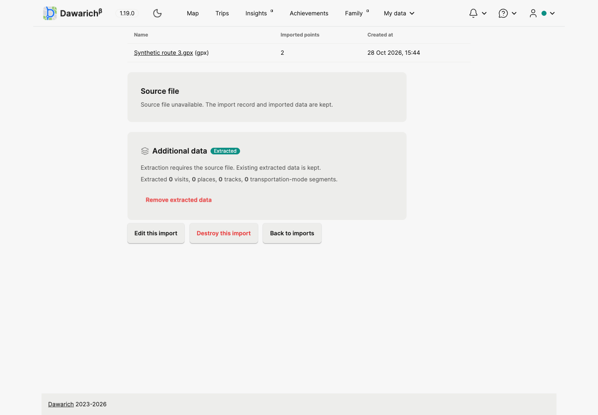
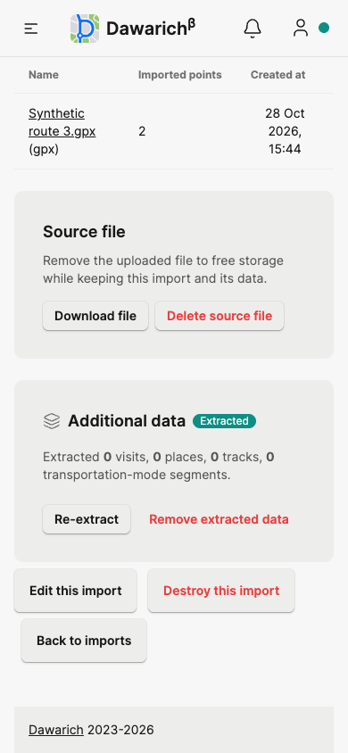
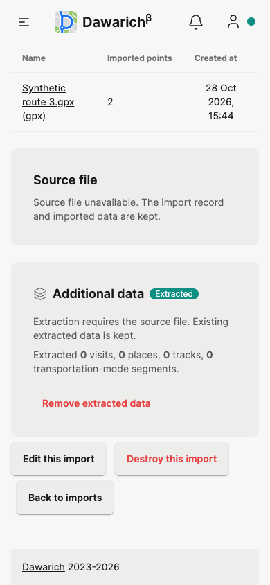

# Import source file removal: local verification

Date: 2026-10-28. Issue [#3531](https://github.com/Freika/dawarich/issues/3531). Branch `codex/issue-3531-delete-import-source`, based on `dev` at `13ec7af9e`. Design and operating constraints: [source-file removal ADR](adr/20261028-import-source-file-removal.md).

## Environment

Ruby 4.0.9, Rails 8.1.3.1, Node 22.22.0. Private Docker containers `dawarich-3531-db` (`imresamu/postgis:17-3.5-alpine`, localhost:15531) and `dawarich-3531-redis` (`redis:7-alpine`, localhost:16531). Test database `dawarich_3531_test`; separate browser database `dawarich_3531_browser`. Cache/queue DBs 3/4 for the browser. Uploaded bytes are synthetic and stored only in this worktree's `tmp/storage`. No SSH or production access.

The browser app used localhost:13531 and `WEB_CONCURRENCY=0`. The initial macOS Puma cluster failed in `pg` after fork; the single-process rerun passed. This is a local test harness choice; product Puma configuration was not changed. The declared Node version in package.json is 18.17.1; this run used the installed Node 22.22.0.

## Automated checks

- **854 related RSpec examples, zero failures**. The suite also generates Swagger through **269 dry-run examples**; those are not live API tests.
- **736 JavaScript tests, zero failures** (`npm test`).
- **RuboCop: 24 changed Ruby files, zero offenses**, excluding generated `db/schema.rb`.
- Tailwind CSS build and `git diff --check` passed.
- Fresh schema load plus down/up of migration `20261028143000` passed in disposable local databases.

RSpec packet (activate the repository's Ruby and set database/Redis variables to an isolated test environment first):

```sh
bundle exec rspec \
  spec/models/import_spec.rb spec/policies/import_policy_spec.rb spec/policies/imports \
  spec/requests/imports_spec.rb spec/requests/imports spec/requests/import_source_file_spec.rb \
  spec/jobs/import spec/jobs/imports spec/jobs/enhanced_import \
  spec/jobs/users/import_data_job_spec.rb spec/jobs/transportation_modes \
  spec/services/imports spec/services/points/device_tag_backfiller_spec.rb \
  spec/services/transportation_modes/activity_backfiller_spec.rb \
  spec/services/users/export_data spec/services/users/import_data \
  spec/jobs/data_migrations/unwrap_legacy_imports_job_spec.rb
```

The new service tests cover unchanged import attributes (apart from attachment touch timestamps), point counts/IDs and extracted place/visit/track IDs; separate and shared prepared blobs; a blob referenced by another import; after-commit purge and rollback; repeat and stale requests; terminal and busy states; excluded archive/API imports; a reader that starts before the processing status changes; stale processing/download jobs; extraction claims in both orderings; device-tag backfill and account backup concurrency.

Request tests cover owner-only access, signed-out access, direct busy requests, missing-source download/index/show/edit/rename/points views, denied re-extraction, retained extracted-data removal, whole-import deletion after source removal, queued download preparation and requeue after cache expiry. All seven supported locales render translated confirmations. Restore does not inherit a download queue claim.

## Browser and actual storage checks

Playwright CLI session `issue3531-desktop` was isolated and closed after verification. Chromium desktop at 1280×720 and 1440×1000, and mobile viewport at 390×844, were exercised in dark/light themes. This is viewport emulation, not physical-device Safari testing.

Verified:

1. Owner can open the import, see Download and Delete source file, and cancel the confirmation without removing the file.
2. The confirmation explains retained import/points/visits/places/tracks and the loss of file-dependent capabilities.
3. Confirming removal keeps the import and its point count, removes download/re-extraction controls, retains extraction counts and the separate extracted-data removal action, and shows a cleanup notice.
4. A direct stale download URL returns to the import with an explanation, without a server error.
5. Whole-import deletion from the list explicitly warns about imported points and extracted data; cancel keeps the record.
6. Mobile page width equals the 390-pixel viewport before and after removal. The import metadata table contains its date tooltip overflow instead of widening the page. No console errors/warnings on the final import-page flow. A map sprite fetch failed on an earlier login/theme redirect; map rendering was not an acceptance criterion for this change.

Three synthetic browser imports retained exactly their original point IDs: import 1 → `[1, 2]`, import 2 → `[3, 4]`, import 3 → `[5, 6]`. Three purge jobs queued by the browser requests were executed in a separate Rails process against only the private browser queue. Their blob rows and physical storage objects disappeared; all six point IDs and three import rows remained. No real user files were removed.

Screenshots:

| Before | After |
| --- | --- |
|  |  |
|  |  |

## Limits and handoff

Full unfiltered RSpec, the separate private browser E2E repository, physical devices and remote storage providers were not tested. PostgreSQL/Active Storage shared-blob behavior was exercised on local Disk storage. The new migration must be applied and all web/worker processes restarted to use the common source lock. Pending/running extraction is deliberately never expired merely to enable file removal. Restore archives and API-generated Immich/PhotoPrism imports remain excluded, with an explanation in the UI.

No push, PR, merge or deployment. Task-owned app/database/Redis services are stopped after verification; the worktree and committed evidence remain available for review.
